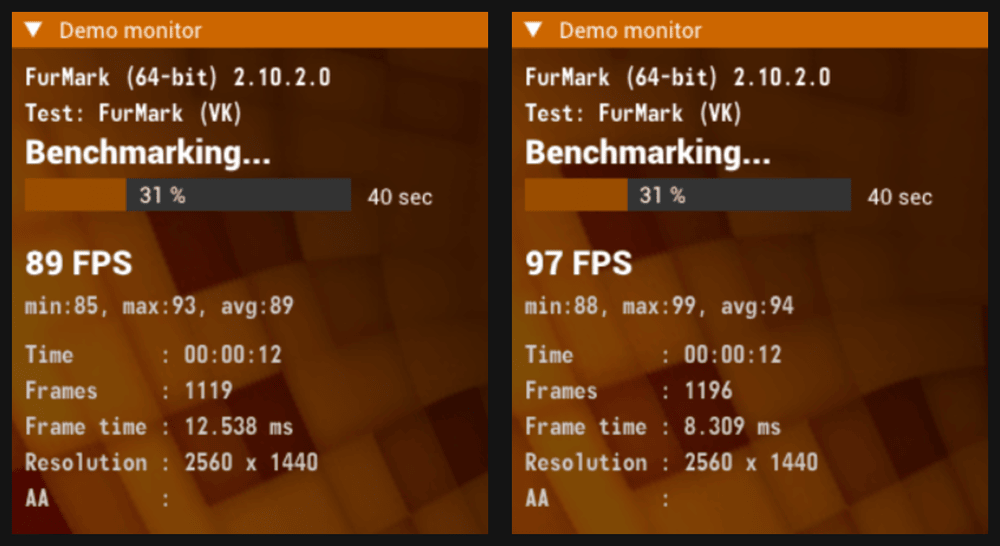

# gpu-power-policy

**Live control of a Linux laptop's NVIDIA GPU power and current limits.** Raise the GPU power ceilings once, then change the active limits in seconds, with the firmware confirming each current change. The ceilings live in an in-memory copy of your VBIOS edited at boot; nothing is ever written or flashed to the card, and every override releases on request. It installs as one NixOS module or one script on Fedora and Ubuntu.

gpu-power-policy first independently demonstrated an in-memory policy edit and runtime current control on an Ampere laptop, on driver 595.99.02.

For you if: an NVIDIA laptop GPU (desktop cards untested), driver exactly 615.71.09, and load power stuck below its rated maximum, on NixOS, Fedora 43 or Ubuntu 24.04. Experimental; read the [support boundary](#support-boundary) first.

## Results

Same laptop, same driver, FurMark 2.10.2 Vulkan at 2560×1440 fullscreen on the laptop panel, 120 s per run, AC power, external cooler, Turbo on, 125 W board-power target throughout. Only the NVVDD (GPU core rail) current limit changed, in A-B-B-A order so drift would show. Power is the mean over seconds 20–110; the score covers the whole run.

| Run | Current limit | Mean GPU power | FurMark score |
|---|---:|---:|---:|
| A1 | 99 A (stock) | 117.7 W | 10 703 |
| B1 | 107 A | 124.6 W | 11 352 |
| B2 | 107 A | 124.6 W | 11 352 |
| A2 | 99 A (stock) | 117.8 W | 10 741 |
| Control, Turbo off | 99 A (stock) | 117.8 W | 10 704 |

**+5.8 % delivered power, +5.9 % score**, repeats within 0.4 % (the two 107 A runs scored identically), peak GPU temperature 58 °C.

On 595.99.02 the same plateau held (112 W stock against a 115 W maximum, about 118 W at a 125 W target), and a 95 A limit lowered clocks 7–9 %: the current limit is enforced.

Per-run record: [2026-10-25-615-abba.json](docs/evidence/2026-10-25-615-abba.json).



The same laptop, the same second of two otherwise identical runs, with the board-power target at 125 W throughout and only the current limit changed from 99 to 107 A. Telemetry over those runs: 117.3 W and 780 MHz against 124.0 W and 1012 MHz, peaking at 54 °C.

## Compared with the VBIOS editor and loader

Raising a ceiling is the easy half; the firmware still has to be asked for more. This repo asks: an `nvidia-powerd` preload for the board-power target where Dynamic Boost runs, or a direct limit request where it does not, and a resource-manager client for the NVVDD current limit. That the Ampere NVVDD policy actually binds is this project's own measurement. On driver 615 the edit and the in-memory load use [nvidia-vbios-vix-editor/nvidia-linux-vbios-vix-loader](https://github.com/Panchovix) unmodified, in place of this project's own [595-series transport](https://github.com/Nickdom1/gpu-power-policy/blob/dcfaa6010c0d8861cdd60103b5b5ee66374440d2/module/policy-shim.patch), published 25 October 2026.

| | Editor and loader only | With this repo |
|---|---|---|
| Raise board-power and current ceilings | yes | yes, same editor |
| Raised ceiling takes effect on a Dynamic Boost laptop | not by itself: `nvidia-powerd` keeps requesting the stock target | yes, target override |
| Change the current limit | edit the image, reboot | in seconds, firmware-verified |
| Change the board-power target | no | in seconds |
| Raise the limit without Dynamic Boost (VM, desktop) | no | `gpu-power limit`, direct firmware request |
| Release runtime overrides | n/a | `target off`, `current off`, `off` |
| Refuses to raise limits if the image was not staged | n/a | yes |
| Obtain your ROM | separate step (sysfs, nvflash, GPU-Z) | `gpu-power rom` |
| Declarative install | out of scope | NixOS module, or one script on Fedora and Ubuntu |
| Windows, GUI, many tested GPUs | yes | no |

## The CLI

All commands run as root and print JSON.

```
gpu-power rom gpu.rom       # export the retained boot ROM to a new private file
gpu-power status            # version, image staging, target state, power readback, policy tables
gpu-power target 125        # set the powerd Dynamic Boost target to 125 W (restarts nvidia-powerd)
gpu-power target off        # remove the override; stock targets resume
gpu-power limit 125         # request 125 W through NVML, falling back to the firmware limit request
gpu-power limit off         # restore the configured stock power limit
gpu-power current 107000    # set the NVVDD current limit to 107 A, verify by readback
gpu-power current off       # restore the configured rated current
gpu-power off               # restore rated current, remove the target and restore the stock limit
gpu-power dump DIRECTORY    # save raw policy replies for diagnosis or a bug report
```

Changes last until released, the GPU reinitialises or you reboot. Values are bounded by the image's ceilings and the firmware's own reported bounds; you cannot go below rated.

## Install

Two rounds either way: the first boot exports your ROM, the second applies the edited image. Prerequisites, the full option list, verification and rollback are in [docs/install.md](docs/install.md).

```nix
hardware.gpuPowerPolicy = {
  enable = true;
  device = "0000:01:00.0";            # your GPU
  vbios = builtins.fetchurl {         # null on the first round: export only
    url = "file:///var/lib/gpu.rom";  # kept out of your flake; see docs/install.md
    sha256 = "<printed by gpu-power rom>";
  };
  powerCeilingWatts = 140;            # the tested laptop's values: read yours from your ROM
  powerDefaultWatts = 80;
  currentCeilingMilliamps = 120000;
  currentRatedMilliamps = 99000;
  powerdTargetWatts = 125;            # the one active change at boot; needs vbios set
};
```

On Fedora and Ubuntu the same fields live in a JSON file, and Debian-family derivatives use that path unchanged: `sudo bash install/linux.sh gpu-power.json`.

## Support boundary

Validated on one machine: an RTX 3080 Ti Laptop GPU in an Acer PT516-52s, driver exactly 615.71.09. Run it on AC, supervised, and watch temperatures on the first runs. What is untested, what the limits mean and what the known failure modes are: [docs/known-gaps.md](docs/known-gaps.md).

## Checks and bug reports

`python3 -m unittest discover -s tests` runs the CPU suites, as CI does on every push; `nix flake check` adds the Nix evaluations and `nix build .#kernel-module` builds the patched driver. For a report attach `sudo gpu-power dump DIR`, `nvidia-smi -q -d POWER` and the `vbios_override` kernel log line. The dated research history and a map of related work are on the [research/v0.1 branch](https://github.com/Nickdom1/gpu-power-policy/tree/research/v0.1).

## Credits and licence

MIT. Uses Panchovix's nvidia-vbios-vix-editor (GPL-3.0-or-later, external tool) and the MIT loader patch from nvidia-linux-vbios-vix-loader; notices and prior art in `NOTICE`.
