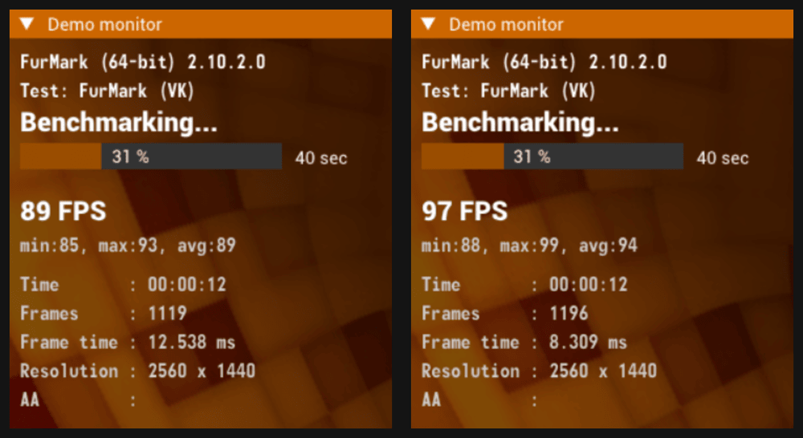
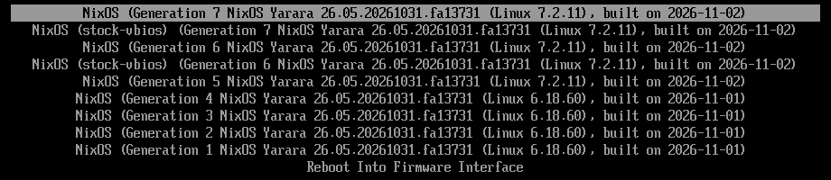

# gpu-power-policy

**Live control of a Linux laptop’s NVIDIA GPU power and current limits.** Install once for stock-range controls. Raise ceilings deliberately if needed, then change active limits with firmware readback. An edited VBIOS is staged in memory at boot; nothing is flashed to the card.

gpu-power-policy independently demonstrated an in-memory policy edit and runtime current control on an Ampere laptop, on driver 595.99.02.

For Turing and Ampere laptops on NixOS, Fedora 43, Ubuntu 24.04 or CachyOS, with the NVIDIA 615.78.08 driver this project installs. Ada laptops get the stock-range power controls; Blackwell is unsupported. Desktops already have stock power control through `nvidia-smi -pl`.

## Results

One RTX 3080 Ti Laptop GPU (GA103), same driver, FurMark 2.10.2 Vulkan at 2560×1440 fullscreen on the laptop panel, 120 s per run, AC power, external cooler, Turbo on, 125 W board-power target throughout. Only the NVVDD (GPU core rail) current limit changed, in A-B-B-A order so drift would show. Power is the mean over seconds 20–110; the score covers the whole run.

| Run | Current limit | Mean GPU power | FurMark score |
|---|---:|---:|---:|
| A1 | 99 A (stock) | 117.7 W | 10 703 |
| B1 | 107 A | 124.6 W | 11 352 |
| B2 | 107 A | 124.6 W | 11 352 |
| A2 | 99 A (stock) | 117.8 W | 10 741 |
| Control, Turbo off | 99 A (stock) | 117.8 W | 10 704 |

**+5.8 % delivered power, +5.9 % score**, repeats within 0.4 % (the two 107 A runs scored identically), peak GPU temperature 58 °C.

On 595.99.02 the same plateau held (112 W stock against a 115 W maximum, about 118 W at a 125 W target), and a 95 A limit lowered clocks 7–9 %: the current limit is enforced.

The earlier stock-range target override reached the 115 W stock maximum for +3.6% score, from about 112 W stock. The larger gain above needs the current raise.

Per-run record: [2026-10-25-615-abba.json](docs/evidence/2026-10-25-615-abba.json).



The same laptop, the same second of two otherwise identical runs, with the board-power target at 125 W throughout and only the current limit changed from 99 to 107 A. Telemetry over those runs: 117.3 W and 780 MHz against 124.0 W and 1012 MHz, peaking at 54 °C.

## Compared with the VBIOS editor and loader

The pinned [Panchovix editor and loader](https://github.com/Panchovix) provide the image edit and in-memory load. This project adds runtime requests and firmware verification; its Ampere NVVDD enforcement result is an independent measurement. The earlier [595 transport](https://github.com/Nickdom1/gpu-power-policy/blob/dcfaa6010c0d8861cdd60103b5b5ee66374440d2/module/policy-shim.patch) was published on 25 October 2026.

| Operation | Editor and loader only | With this project |
|---|---|---|
| Raise supported image ceilings | Yes | Same editor, ROM-derived defaults and a +10% cap |
| Runtime stock power cap | Desktops: `nvidia-smi -pl`; laptops: no | `power`, using Dynamic Boost or a direct limit request |
| Hold a Dynamic Boost power target | No | `power max` or a bounded value |
| Runtime current change | Image edit and reboot | `current`, with firmware readback; unavailable on Ada |
| Verify firmware acceptance | Host staging log only | Live maxima must equal the intended ceilings |
| Release runtime overrides | N/A | `off` |

Panchovix’s LACT fork also offers a runtime power cap and a runtime current control that requires an unpublished helper.

## The CLI

Run as root. Normal commands print a short result. Add `--json` for scripts; `status --full` includes the raw policy tables.

```sh
sudo gpu-power status
sudo gpu-power power max
sudo gpu-power current max
sudo gpu-power off
sudo gpu-power status --full
sudo gpu-power dump diagnostic-directory
```

`power` and `current` accept `max`, `+N%` over the ROM maximum, an absolute value in W/mA, or `off`. Percentage requests round to whole watts or whole amps. Both the live firmware bounds and configured ceiling apply. At stock, `current max` usually reports that it is already at the rated value and changes nothing.

## Install

Start with the read-only check. It tells you whether your machine is supported and what to do next. Expect one reboot, plus one for Secure Boot key enrollment and one if you raise a ceiling.

**NixOS**

```sh
nix run github:Nickdom1/gpu-power-policy#preflight
```

Then follow [Install on NixOS](docs/install.md#install-on-nixos): two configuration lines and one `nixos-rebuild boot`.

**Fedora, Ubuntu, CachyOS**

```sh
git clone https://github.com/Nickdom1/gpu-power-policy.git
cd gpu-power-policy
bash install/preflight.sh
```

Then follow your distro's section in [docs/install.md](docs/install.md).

## Recovery

If a raised boot loses the display, on NixOS select the **stock-vbios entry at the boot menu**; if the driver itself cannot start, choose the previous generation.



With an editable boot entry on Fedora, Ubuntu or CachyOS, append this one-time parameter:

```text
nvidia.NVreg_RegistryDwords=RmLinuxVbiosOverrideDisable=1
```

Expect stock bounds and `Unverified`; follow the CLI's `Run:` command to disable the saved image. Signed Limine can prohibit editing: use its pre-install snapshot instead. [Boot-menu steps, expected status and offline recovery](docs/install.md#recovery).

## Support boundary

Validated on the board in Results. Ada has power control only; the pinned editor cannot raise Ada laptop images.

The Dynamic Boost target override replaces the daemon’s CPU/GPU and adapter arbitration and applies on battery too. There is no AC or temperature watchdog, and regulator temperature is not monitored: run on AC, supervised. [Known gaps](docs/known-gaps.md).

## Checks and bug reports

`python3 -m unittest discover -s tests`, the C shim test, shellcheck, ruff (including B905 and E501), and `nix flake check` cover CPU behavior, Nix integration, and the pinned editor. For a report include `sudo gpu-power status --full`, `sudo gpu-power dump diagnostic-directory`, `nvidia-smi -q -d POWER` and the full `vbios_override:` kernel log line.

The dated research history is on [research/v0.1](https://github.com/Nickdom1/gpu-power-policy/tree/research/v0.1).

## Credits and licence

MIT. Uses Panchovix’s nvidia-vbios-vix-editor (GPL-3.0-or-later, external tool) and the MIT loader patch from nvidia-linux-vbios-vix-loader. See `NOTICE`.
