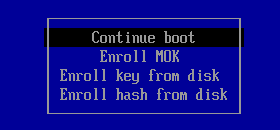
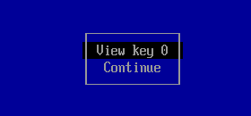
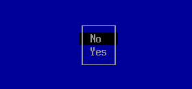
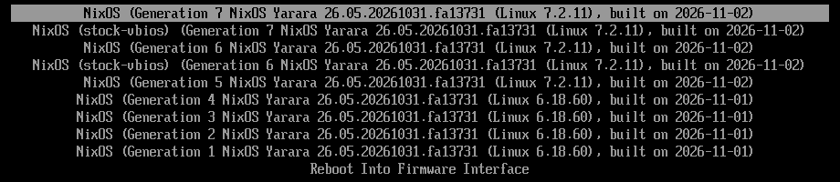
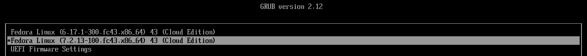
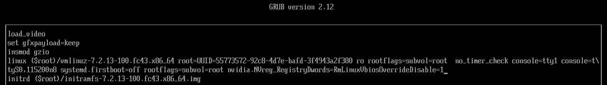
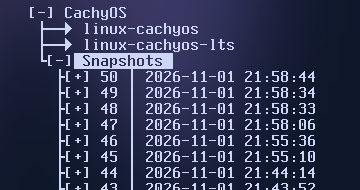

# Install gpu-power-policy

[**NixOS**](#install-on-nixos) · [**Fedora 43**](#install-on-fedora-43) · [**Ubuntu 24.04**](#install-on-ubuntu-2404) · [**CachyOS**](#install-on-cachyos) · [Recovery](#recovery) · [Secure Boot](#secure-boot)

Install once to control limits within the GPU's stock range. An optional second installation raises a ceiling by loading an edited image into memory; it never flashes the card. The first installation normally needs one reboot, MOK enrollment can add another, and a ceiling raise needs another. Driver compilation takes several minutes.

This guide installs NVIDIA **615.78.08**. The examples below are real output from an Ampere passthrough guest; your PCI address, limits, package names and Dynamic Boost availability can differ.

## Before you start

| GPU | What this installation provides |
|---|---|
| Turing or Ampere laptop | Stock power/current controls; optional ceiling raises |
| Ada laptop | Stock power controls; image raises and current control are unavailable |
| Turing or Ampere desktop | Stock power control already exists through `nvidia-smi -pl` |
| Ada desktop | Experimental power ceiling raises; no current control |
| Blackwell or older than Turing | Unsupported |

- Use AC power and keep network access available for installation.
- Keep your working OS configuration and the checkout. Later raises use that checkout; printed repair commands include its path while it exists.
- On Fedora and Ubuntu you remove the distro NVIDIA driver before installing this one. CachyOS removes its packaged kernel module; the installer replaces and pins NVIDIA userspace.
- NixOS keeps its declarative configuration and previous generations. Its project input pins the kernel and NVIDIA driver together.
- Read the [tested hardware limits](known-gaps.md) before raising a ceiling.

## Check your machine

**NixOS:** use the preflight command from your normal user account:

```sh
nix run github:Nickdom1/gpu-power-policy#preflight
```

**Fedora, Ubuntu and CachyOS:** the OS section below installs Git, clones the project and runs the same check through `install/preflight.sh`.

Preflight reads the machine without changing packages, loading a driver or writing boot files. Read `Verdict` and every `Also blocked` line. A `Supported` verdict allows the stock installation. Missing kernel headers are installed automatically.

<details>
<summary>Example: a supported NixOS machine</summary>

The output is similar to the following:

```text
GPU           01:00.0 VGA compatible controller [0300]: NVIDIA Corporation GA103M [GeForce RTX 3080 Ti Laptop GPU] [10de:2460] (rev a1); ampere, laptop
Power/driver  NVIDIA GeForce RTX 3080 Ti Laptop GPU, 595.71.05, 80.00 W, 115.00 W
Dynamic Boost off or unavailable
Secure Boot   off, kernel lockdown unavailable; signing is your boot chain's responsibility (for example lanzaboote); this module does not sign
Kernel        6.18.60; headers: managed by Nix
Verdict       Supported. Run: follow https://github.com/Nickdom1/gpu-power-policy/blob/main/docs/install.md#install-on-nixos.
```

</details>

<details>
<summary>If preflight reports a blocker</summary>

| Message | Next action |
|---|---|
| A packaged NVIDIA driver or kernel module is installed | Review and run the exact removal command printed for your machine; rerun preflight |
| Multiple NVIDIA GPUs | Rerun the printed command with the desired `--device` address |
| GPU identification tools are unavailable | Install the tool named in the printed command, then rerun preflight |
| Kernel lockdown requires signing | Follow [Secure Boot](#secure-boot); Fedora/Ubuntu enrollment is part of installation |
| Unsupported OS or GPU | Stop; the installer does not provide that path |

</details>

## Install on NixOS

**What you get:** the pinned kernel and patched NVIDIA driver, the `gpu-power` command, and stock-range controls after reboot. Your current generation stays available for recovery.

Use your normal account in the directory containing your host's `flake.nix`; it can be outside `/etc/nixos`. These commands use NixOS 26.05's `nixos-rebuild`. Replace `HOSTNAME` with your key under `nixosConfigurations`.

<details>
<summary>If this host does not have a flake yet</summary>

Start from your existing working NixOS configuration. Copy its files, including any additional imported modules, into a Git directory you own. A fresh installation with the two standard files can use:

```sh
mkdir -p ~/nixos-config
cp /etc/nixos/configuration.nix /etc/nixos/hardware-configuration.nix ~/nixos-config/
cd ~/nixos-config
git init
```

Enable the `nix-command` and `flakes` experimental features in your existing Nix configuration if they are not already enabled. The minimal flake below uses the copied `configuration.nix`; retain that file's hardware and bootloader settings.

</details>

1. Add the project input and module to your host flake. This is a complete minimal example; an existing flake keeps its other inputs and modules:

```nix
{
  inputs.nixpkgs.url = "github:NixOS/nixpkgs/nixos-26.05";
  inputs.gpu-power-policy.url = "github:Nickdom1/gpu-power-policy";

  outputs = inputs@{ nixpkgs, ... }: {
    nixosConfigurations.HOSTNAME = nixpkgs.lib.nixosSystem {
      system = "x86_64-linux";
      modules = [
        ./configuration.nix
        inputs.gpu-power-policy.nixosModules.default
        {
          boot.kernelPackages = inputs.gpu-power-policy.kernelPackages.x86_64-linux;
          hardware.gpuPowerPolicy.enable = true;
        }
      ];
    };
  };
}
```

The kernel line selects the project's tested kernel/driver pair; replace any existing `boot.kernelPackages` assignment with it. Keep the project input's own nixpkgs pin: adding `inputs.gpu-power-policy.inputs.nixpkgs.follows` would replace that pair with your host's packages. If your configuration explicitly sets `hardware.nvidia.open = false`, change it to `true`.

<details>
<summary>If you already have an alternate-kernel specialisation</summary>

Keep that entry on its own driver by setting `hardware.gpuPowerPolicy.enable = lib.mkForce false;` inside its `configuration`. The project requires its pinned kernel/driver pair wherever it is enabled. The generated stock-vbios entry uses that same pair and needs no extra setting.

</details>

2. Track the flake and its imported files, then build the next boot from this directory. For the minimal example:

```sh
git add flake.nix configuration.nix hardware-configuration.nix
nixos-rebuild boot --sudo --flake .#HOSTNAME
git add flake.lock
```

`--sudo` builds as the flake's owner and elevates boot-entry installation. Use **`boot`**: `switch` can replace NVIDIA userspace while the old kernel module remains loaded, causing a driver/library mismatch. Track other imported files too; Git flakes exclude untracked files.

<details>
<summary>Example: a completed build</summary>

The output ends similarly to:

```text
Not checking switch inhibitors (action = boot)
Done. The new configuration is /nix/store/2vkrxgw7cjg83c5jkk8zhah4wbdpfnky-nixos-system-gpu-lab-nixos-26.05.20261031.fa13731
```

</details>

3. Reboot:

```sh
sudo reboot
```

Continue at [Use the stock controls](#use-the-stock-controls). If this first driver boot fails, select the previous generation at the boot menu. A later raised configuration also supplies a `stock-vbios` entry.

## Install on Fedora 43

**What you get:** the patched driver and matching userspace, automatic signing when required, the CLI, and a kernel-update hook using the saved source.

1. Install Git if it is missing:

```sh
sudo dnf install git
```

2. Clone the project and enter its directory:

```sh
git clone https://github.com/Nickdom1/gpu-power-policy.git
cd gpu-power-policy
```

3. Check the machine:

```sh
bash install/preflight.sh
```

4. If it reports a packaged NVIDIA driver, review and run its printed removal command. The Fedora command includes `--no-autoremove` to retain the desktop's other dependencies. The installer itself never removes your distro driver.

<details>
<summary>Example removal message — copy your own printed command</summary>

```text
Verdict       Blocked: a packaged NVIDIA driver is installed (akmod-nvidia, kmod-nvidia-6.17.1-300.fc43.x86_64, kmod-nvidia-7.2.13-100.fc43.x86_64, nvidia-modprobe, nvidia-persistenced, nvidia-settings, xorg-x11-drv-nvidia, xorg-x11-drv-nvidia-cuda, xorg-x11-drv-nvidia-cuda-libs, xorg-x11-drv-nvidia-kmodsrc, xorg-x11-drv-nvidia-libs, xorg-x11-drv-nvidia-power, xorg-x11-drv-nvidia-xorg-libs). Run: sudo dnf remove --no-autoremove akmod-nvidia kmod-nvidia-6.17.1-300.fc43.x86_64 kmod-nvidia-7.2.13-100.fc43.x86_64 nvidia-modprobe nvidia-persistenced nvidia-settings xorg-x11-drv-nvidia xorg-x11-drv-nvidia-cuda xorg-x11-drv-nvidia-cuda-libs xorg-x11-drv-nvidia-kmodsrc xorg-x11-drv-nvidia-libs xorg-x11-drv-nvidia-power xorg-x11-drv-nvidia-xorg-libs, then run the preflight again.
```

</details>

5. Rerun preflight and resolve any remaining blockers:

```sh
bash install/preflight.sh
```

6. Install without required arguments:

```sh
sudo bash install/linux.sh
```

With Secure Boot signing required, choose the one-time enrollment password when prompted. The installer asks before the long build. Follow [Enroll the signing key](#enroll-the-signing-key-fedora-and-ubuntu) at the next boot.

<details>
<summary>Example: installer output</summary>

The output is similar to the following:

```text
Preparing the signing key, if required.
Secure Boot / kernel lockdown requires signing. Modules will be signed with a Machine Owner Key.
Choose a one-time password now. At the next boot a blue "Perform MOK management" screen
appears: choose Enroll MOK, Continue, Yes, type the password, Reboot.
input password:
input password again:
Installing build tools and kernel headers.
Fetching and patching the NVIDIA source.
Building the NVIDIA driver.
Installing NVIDIA userspace.
Installing the CLI, editor and boot configuration.
Updating boot files.
Installed NVIDIA 615.78.08 with VBIOS override support for 0000:01:00.0, kernel 6.17.1-300.fc43.x86_64.
Reboot, then run: sudo gpu-power status
```

</details>

7. Reboot, complete enrollment if requested, then continue at [Use the stock controls](#use-the-stock-controls):

```sh
sudo reboot
```

## Install on Ubuntu 24.04

**What you get:** the same driver and CLI, Ubuntu-compatible signing, and a hook that rebuilds the module when Ubuntu installs a kernel.

1. Install Git if it is missing:

```sh
sudo apt-get update
sudo apt-get install git
```

2. Clone the project and enter its directory:

```sh
git clone https://github.com/Nickdom1/gpu-power-policy.git
cd gpu-power-policy
```

3. Check the machine:

```sh
bash install/preflight.sh
```

4. If it reports a packaged NVIDIA driver, review and run its printed `apt-get purge` command. Keep its exact package list. Do not run `apt autoremove` until the project driver is installed.

<details>
<summary>Example removal message — copy your own printed command</summary>

```text
Verdict       Blocked: a packaged NVIDIA driver is installed (libnvidia-cfg1-615, libnvidia-common-615, libnvidia-compute-615, libnvidia-decode-615, libnvidia-egl-wayland1, libnvidia-encode-615, libnvidia-extra-615, libnvidia-fbc1-615, libnvidia-gl-615, linux-modules-nvidia-615-open-6.8.0-147-generic, nvidia-compute-utils-615, nvidia-dkms-615-open, nvidia-driver-615-open, nvidia-firmware-615-615.71.09, nvidia-kernel-common-615, nvidia-kernel-source-615-open, nvidia-utils-615, xserver-xorg-video-nvidia-615). Run: sudo apt-get purge libnvidia-cfg1-615 libnvidia-common-615 libnvidia-compute-615 libnvidia-decode-615 libnvidia-egl-wayland1 libnvidia-encode-615 libnvidia-extra-615 libnvidia-fbc1-615 libnvidia-gl-615 linux-modules-nvidia-615-open-6.8.0-147-generic nvidia-compute-utils-615 nvidia-dkms-615-open nvidia-driver-615-open nvidia-firmware-615-615.71.09 nvidia-kernel-common-615 nvidia-kernel-source-615-open nvidia-utils-615 xserver-xorg-video-nvidia-615, then run the preflight again.
```

</details>

5. Rerun preflight and resolve any remaining blockers:

```sh
bash install/preflight.sh
```

6. Install without required arguments:

```sh
sudo bash install/linux.sh
```

Ubuntu with Secure Boot normally requests a one-time MOK password before compilation. Follow [Enroll the signing key](#enroll-the-signing-key-fedora-and-ubuntu). The installer obtains the running kernel's headers, including the supported HWE package layout.

<details>
<summary>Example: installer output</summary>

The output is similar to the following:

```text
Preparing the signing key, if required.
Secure Boot / kernel lockdown requires signing. Modules will be signed with a Machine Owner Key.
Choose a one-time password now. At the next boot a blue "Perform MOK management" screen
appears: choose Enroll MOK, Continue, Yes, type the password, Reboot.
input password:
input password again:
Installing build tools and kernel headers.
Fetching and patching the NVIDIA source.
Building the NVIDIA driver.
Installing NVIDIA userspace.
Installing the CLI, editor and boot configuration.
Updating boot files.
Installed NVIDIA 615.78.08 with VBIOS override support for 0000:01:00.0, kernel 6.8.0-147-generic.
Reboot, then run: sudo gpu-power status
```

</details>

7. Reboot, complete enrollment if requested, then continue at [Use the stock controls](#use-the-stock-controls):

```sh
sudo reboot
```

## Install on CachyOS

**What you get:** the patched module, matching NVIDIA userspace held at its pinned version, the CLI, and a hook that runs before boot-image generation.

CachyOS does not use the Fedora/Ubuntu MOK flow. Enforcing signature lockdown is refused; see [Secure Boot](#secure-boot). On a Btrfs installation with CachyOS's snapshot integration, confirm before changing the driver that your normal pre-install snapshot is available under **Snapshots** in Limine; see [Recovery](#recovery).

1. Install Git if it is missing:

```sh
sudo pacman -S --needed git
```

2. Clone the project and enter its directory:

```sh
git clone https://github.com/Nickdom1/gpu-power-policy.git
cd gpu-power-policy
```

3. Check the machine:

```sh
bash install/preflight.sh
```

4. If it reports a packaged NVIDIA kernel module, review and run its printed `pacman -R` command. It identifies the installed package; do not substitute a guessed name.

<details>
<summary>Example removal message — copy your own printed command</summary>

```text
Verdict       Blocked: a packaged NVIDIA kernel module is installed (linux-cachyos-lts-nvidia-open, linux-cachyos-nvidia-open). Run: sudo pacman -R linux-cachyos-lts-nvidia-open linux-cachyos-nvidia-open, then run the preflight again.
```

</details>

5. Rerun preflight:

```sh
bash install/preflight.sh
```

<details>
<summary>Optional: keep an LTS fallback</summary>

Install the LTS kernel and its headers before proceeding:

```sh
sudo pacman -S linux-cachyos-lts linux-cachyos-lts-headers
```

</details>

6. Install:

```sh
sudo bash install/linux.sh
```

The installer handles the main kernel's Clang build and other installed kernels with headers. It installs `nvidia-utils` 615.78.08-2 and, with multilib enabled, `lib32-nvidia-utils` 615.78.08-1. Subsequent pacman “ignored package” messages for these packages are expected.

<details>
<summary>Example: installer output</summary>

The output is similar to the following:

```text
Preparing the signing key, if required.
Installing build tools and kernel headers.
Fetching and patching the NVIDIA source.
Building the NVIDIA driver.
Installing NVIDIA userspace.
pacman will report the pinned NVIDIA userspace packages as ignored during upgrades.
Installing the CLI, editor and boot configuration.
Building drivers for other installed kernels with headers.
Updating boot files.
Installed NVIDIA 615.78.08 with VBIOS override support for 0000:01:00.0, kernel 7.3.1-1-cachyos.
Reboot, then run: sudo gpu-power status
```

</details>

7. Let any native snapshot updates finish, then reboot and continue below. On a signed Limine setup, read the [Secure Boot note](#secure-boot) first:

```sh
sudo reboot
```

## Enroll the signing key (Fedora and Ubuntu)

Skip this section if the installer did not request enrollment. A Machine Owner Key lets your Secure Boot installation trust the locally built driver. Signing is automatic; enrollment requires your choice at the firmware screen.

> [!IMPORTANT]
> The installer disables the MOK screen's timeout and queues the key in separate commands. At the blue screen, choose enrollment instead of continuing to boot. Use the one-time password you entered during installation.

| Screen | Choose or enter | Actual enrollment screen |
|---|---|---|
| Perform MOK management | **Enroll MOK**, then Enter |  |
| Enroll MOK | **Continue**, then Enter |  |
| Enroll the key(s)? | **Yes**, then Enter |  |
| Password | Your one-time enrollment password | |
| Completion | **Reboot** | |

These crops are from the tested Ubuntu enrollment; Fedora presents the same choices.

If you missed enrollment, return to the checkout and rerun the installer. It checks whether the key is enrolled and queues it again when necessary:

```sh
sudo bash install/linux.sh
sudo reboot
```

## Use the stock controls

All four OS paths rejoin here. Check the installed driver and the card's actual limits:

```sh
sudo gpu-power status
```

Expect `Ready (stock)` before changing limits. The output is similar to:

```text
Ready (stock): 615.78.08 on 0000:01:00.0, stock VBIOS. Power 80 W default, 115 W maximum. Current 99 A rated, 99 A maximum. Dynamic Boost off. No overrides active.
Next: sudo gpu-power power max
```

Request the stock power maximum for this boot:

```sh
sudo gpu-power power max
```

Release the runtime requests:

```sh
sudo gpu-power off
```

These commands do not rewrite the boot configuration. At stock, `current max` generally already equals the ROM's rated current; Ada has no current control. See the [CLI grammar](../README.md#the-cli) for percentages, absolute values and JSON output.

## Raise a ceiling (optional)

The measured raise is +8% current on one RTX 3080 Ti Laptop GPU, in short supervised runs with an external cooler; the default cap is +10%. Regulator temperature is not monitored, so use AC power and remain present. Ada laptop image raises are unavailable.

### Raise on NixOS

1. From the directory containing your host's `flake.nix`, generate a module using the ROM presented by this card during this boot:

```sh
sudo gpu-power configure --nix --current-ceiling +8% | tee gpu-power-policy.nix
```

The comparison table goes to the terminal; the importable module goes into the file. Review both.

<details>
<summary>Example: the ceiling comparison</summary>

```text
ROM 94.03.19.00.9F, sha256 13051902cd7de8847189df50a4e9a2d84d5fded6215467895ca550198491adb1.
Value                         ROM stock    Live now    Proposed
Power maximum (W)                   115         115         115   +0.0%, within +10% cap
Current maximum (A)                  99          99         107   +8.1%, within +10% cap
Boot defaults stay at the ROM's 80 W and 99 A.
Evidence for raising current: one RTX 3080 Ti Laptop (GA103), +8% current, external cooler, runs of two minutes or less; regulator temperature not measured. Run on AC, supervised.
Save this module beside your host flake.nix, git add it, and add it to imports before rebuilding.
```

</details>

2. Add `./gpu-power-policy.nix` to the host's `modules` list in `flake.nix` (or to your host module's `imports`). Track the file before rebuilding:

```sh
git add flake.nix gpu-power-policy.nix
nixos-rebuild boot --sudo --flake .#HOSTNAME
sudo reboot
```

If you added the import in another file, track that file too. The generated `file://` ROM URL works on this machine; back up `/var/lib/gpu-power-policy/roms` with your configuration. The raised generation automatically includes a **stock-vbios** boot-menu entry for recovery.

### Raise on Fedora, Ubuntu or CachyOS

From the retained checkout, request the ceiling and rebuild the image:

```sh
sudo bash install/linux.sh --current-ceiling +8%
```

The table compares the ROM's original values with the requested ceilings. Defaults remain the ROM's defaults. An existing matching driver is reused.

> [!WARNING]
> Before rebooting a raised configuration, keep [Recovery](#recovery) available on another device. NixOS supplies a stock-vbios entry. GRUB allows a one-boot image-disable parameter. Signed Limine requires an existing working snapshot when entry editing is unavailable.

```sh
sudo reboot
```

### Confirm and use the raised ceiling

All OS paths rejoin again:

```sh
sudo gpu-power status
```

Expect `Ready (raised)` only when the live firmware maxima match the requested ceilings. The output is similar to:

```text
Ready (raised): 615.78.08 on 0000:01:00.0, image from your ROM 94.03.19.00.9F, firmware confirmed. Power 80 W default, 115 W maximum. Current 99 A rated, 107 A maximum. Dynamic Boost off. No overrides active.
Next: sudo gpu-power current max
```

Then request the new current maximum and release it when finished:

```sh
sudo gpu-power current max
sudo gpu-power off
```

If status is not Ready, use its `Run:` instruction before attempting a limit change. Non-Ready status exits non-zero, which also makes it usable in scripts.

### Optional: keep a power target across boots

On NixOS, set `hardware.gpuPowerPolicy.powerdTargetWatts = "max";` in your host module, rebuild with `boot`, then reboot. An integer sets a target in watts.

On Fedora, Ubuntu or CachyOS, from the checkout:

```sh
sudo bash install/linux.sh --boot-power max
sudo reboot
```

An integer replaces `max` for a watt target. The installer retains an existing ceiling request when only the boot target changes.

## After system updates

NixOS keeps the kernel/driver pair pinned to the project input. Fedora, Ubuntu and CachyOS rebuild the saved module source through a kernel-update hook; CachyOS also checks other installed kernels with headers. Keep the checkout for repair commands. If a build fails, save the printed log and follow its repair command before rebooting. The tested Fedora/Ubuntu failures kept the previous kernel bootable without changing the boot default. CachyOS may retain the previous boot image; keep an LTS fallback and complete the repair. Its pinned NVIDIA userspace warnings are expected.

## Recovery

**If a raised boot loses the display**, choose the recovery route for your bootloader below. No network is needed to disable or remove the project.

**NixOS:** select the **stock-vbios entry at the boot menu**. It keeps the pinned kernel, patched driver and CLI, with stock firmware and no image override. Expect stock bounds and `Ready (stock)`. If the driver itself cannot start, select the previous generation; that generation's driver/configuration returns, and `gpu-power` may be absent. Hold Space during startup to reveal a hidden systemd-boot menu. The stock-vbios entry exists only when an edited image is configured.



**Fedora and Ubuntu:** boot once without the edited image by appending this parameter. Keep the existing command line and add a space before it:

```text
nvidia.NVreg_RegistryDwords=RmLinuxVbiosOverrideDisable=1
```

**CachyOS:** use the **Limine (CachyOS default)** instructions below. The same parameter works where the entry editor is available; a signed/enrolled configuration can disable editing.

<details>
<summary>GRUB: Fedora and Ubuntu</summary>

Reveal a hidden menu by pressing Esc during startup (or holding Shift on a BIOS installation). Select the kernel entry and press `e`.



Append the parameter to the line beginning `linux` or `linuxefi`, then press `Ctrl+x` or `F10` to boot once.



Expect `Unverified` with stock bounds: the saved raised request is still present, so this is not `Ready (raised)`. See the [GRUB recovery instructions](https://help.ubuntu.com/community/Grub2/Troubleshooting).

</details>

<details>
<summary>Limine (CachyOS default)</summary>

With signed Limine, `e` does not open an editor. Expand **Snapshots**, select the working snapshot from **before the NVIDIA package removal**, expand it and boot its main kernel. Check the date and package-removal description; snapshot numbers differ. Because that snapshot predates installation, `gpu-power` is absent rather than Ready.



To make the recovery permanent, use CachyOS's native restore tool from the snapshot boot:

```sh
sudo limine-snapper-restore
```

Confirm the displayed snapshot, choose `r` to restore, name the backup when asked, and reboot when restoration finishes. This restores the snapshot's root filesystem, including other system changes since that snapshot; review the [CachyOS snapshot procedure](https://wiki.cachyos.org/configuration/btrfs_snapshots/#restoring-from-a-snapshot).

If your Limine configuration allows editing, select the kernel, press `e`, append the image-disable parameter to `cmdline`, then press `F10` or `Ctrl+x`. Expect `Unverified` with stock bounds. Disabling Secure Boot alone does not unlock a signed menu.

</details>

<details>
<summary>systemd-boot entry editing</summary>

Hold Space to reveal the menu. Select an entry, press `e`, append the parameter and press Enter. Expect `Unverified` with stock bounds. NixOS's stock-vbios entry normally avoids this edit. See [systemd-boot's key bindings](https://www.freedesktop.org/software/systemd/man/latest/systemd-boot.html#Key%20bindings).

</details>

After an image-disable boot, run `sudo gpu-power status` and copy its `Run:` command. For example, the tested Linux checkout printed this instruction:

```text
Run: sudo bash /home/lab/gpu-power-policy/install/linux.sh --disable, then reboot.
```

Use the path printed on **your** machine. This removes persistent image loading; after reboot, expect `Ready (stock)`. If the retained checkout is gone, status falls back to a relative `install/linux.sh` command. Use the installed recovery copy instead; it needs no network:

```sh
sudo bash /usr/local/lib/gpu-power/installer/install/linux.sh --disable
sudo reboot
```

| Status | Meaning |
|---|---|
| Ready (stock) | Stock ROM and live limits agree |
| Ready (raised) | Edited ceilings and live limits agree |
| Missing | The expected driver/device is unavailable |
| Stale | This boot's ROM or selected device differs from the saved request |
| Unverified | Loader evidence or live bounds could not confirm the image |

Each non-Ready status exits non-zero and includes its own `Run:` instruction. Keep any attached error with a bug report.

### If the driver will not start

NixOS uses the previous generation; signed Limine uses the working snapshot above. Where entry editing is available, a second one-boot escape prevents NVIDIA from loading and starts a text target.

Fedora and Ubuntu:

```text
modprobe.blacklist=nvidia,nvidia_drm,nvidia_modeset 3
```

Use the tested five-module form on CachyOS:

```text
modprobe.blacklist=nvidia,nvidia_drm,nvidia_modeset,nvidia_uvm,nvidia_peermem 3
```

Expect `Missing`, a non-zero status exit, and the printed disable command; NVIDIA stays unloaded. Run that command and reboot. The menu edit expires after this boot. On NixOS the kernel-level form `module_blacklist=nvidia,nvidia_drm,nvidia_modeset,nvidia_uvm,nvidia_peermem 3` also reports `Missing`; the previous generation is the normal route.

### If installation or a kernel build fails

The installer prints the log path and the last 30 lines of `/var/log/gpu-power-policy/install.log`. Keep that output. A kernel-update notice names the failed kernel and its repair command. Restore that kernel's headers if they are unavailable, then run the exact command. Successful repair clears that kernel's notice and regenerates its boot files; another kernel's failure notice remains. On CachyOS, select the retained LTS kernel if the main kernel is unusable.

## Turn off, disable or remove

| Action | Result |
|---|---|
| `sudo gpu-power off` | Releases this boot's runtime requests; keeps the installed image and configuration |
| Linux installer `--disable` | Removes edited-image loading and project boot-target integration; keeps the driver and CLI; reboot required |
| Linux installer `--remove` | Removes project tools, hooks and matching driver files, and lifts the CachyOS userspace pin; reinstall the distro driver and reboot |

### NixOS

To keep the project but permanently return to stock firmware, remove the generated raised module import (or set `hardware.gpuPowerPolicy.vbios = null`), rebuild with `boot`, and reboot. Expect `Ready (stock)`. Setting `hardware.gpuPowerPolicy.enable = false` disables the project even if the generated raised import is retained; after reboot the project CLI is absent.

To remove the project, remove the raised configuration/import, all `hardware.gpuPowerPolicy` settings, the project module import, the project input and its explicit kernelPackages line. Restore your previous NVIDIA configuration, rebuild from the host flake, and reboot. Keep a previous working generation until the replacement boots.

```sh
nixos-rebuild boot --sudo --flake .#HOSTNAME
sudo reboot
nvidia-smi
```

<details>
<summary>Fedora removal and distro-driver restore</summary>

From the checkout, remove the project:

```sh
sudo bash install/linux.sh --remove
sudo reboot
```

Using the same NVIDIA package repository as before installation, restore the distro driver:

```sh
sudo dnf install akmod-nvidia xorg-x11-drv-nvidia-cuda
sudo reboot
nvidia-smi
```

The distro's akmods/Secure Boot enrollment requirements apply to its restored driver.

</details>

<details>
<summary>Ubuntu removal and distro-driver restore</summary>

```sh
sudo bash install/linux.sh --remove
sudo reboot
```

Restore the recommended distro driver:

```sh
sudo ubuntu-drivers install
sudo reboot
nvidia-smi
```

Complete the distro's enrollment prompt if it requests one.

</details>

<details>
<summary>CachyOS removal and distro-driver restore</summary>

```sh
sudo bash install/linux.sh --remove
sudo reboot
```

Restore the main kernel's distro module and matching userspace:

```sh
sudo pacman -Syu nvidia-utils lib32-nvidia-utils linux-cachyos-nvidia-open
```

Omit `lib32-nvidia-utils` if multilib is disabled. If you use the LTS kernel, install its matching module before rebooting as well:

```sh
sudo pacman -S linux-cachyos-lts-nvidia-open
```

Then reboot and check the restored driver:

```sh
sudo reboot
nvidia-smi
```

</details>

## Secure Boot

Secure Boot verifies your boot chain. Kernel lockdown determines whether the running kernel accepts unsigned modules; the two readings can differ. Preflight reports both.

| OS | Signing responsibility |
|---|---|
| NixOS | Your existing boot-chain configuration, such as lanzaboote; this module does not provide signing |
| Fedora 43 | The installer reuses an available akmods key or creates a project key, signs the modules and requests MOK enrollment when required |
| Ubuntu 24.04 | The installer uses the shim MOK, creating it when needed, signs the modules and requests enrollment |
| CachyOS | No shim/MOK flow here; enforcing or indeterminate lockdown under Secure Boot is refused. Any sbctl module-signing setup is external to this installer |

<details>
<summary>CachyOS: signed Limine and background snapshot updates</summary>

Rebooting right after a package transaction can interrupt the native background snapshot update and leave Limine unsigned, even after the transaction printed signing messages; firmware then rejects it before Linux starts. Native re-enrollment and signing repair it. This project does not repair or manage the bootloader.

Before rebooting a signed Limine setup after a package transaction, wait for its native snapshot jobs to finish. This observation command should print no running jobs:

```sh
systemctl list-units --state=activating,active --no-legend 'limine-snapper-add-*' 'limine-snapper-delete-*'
```

If firmware rejects Limine, use the [CachyOS Secure Boot procedure](https://wiki.cachyos.org/configuration/secure_boot_setup/) to repair the boot chain; selecting a Linux snapshot cannot repair a bootloader that will not start.

</details>

If you change firmware Secure Boot settings on a dual-boot system, have your Windows BitLocker recovery key available. The MOK enrollment flow is described [above](#enroll-the-signing-key-fedora-and-ubuntu).

## Reference

<details>
<summary>Multiple GPUs</summary>

Use the preflight's printed PCI address with `--device` on the Linux installer. On NixOS set `hardware.gpuPowerPolicy.device` to that address. Runtime commands also accept `--device` before the subcommand. A configured image is specific to its GPU and ROM.

</details>

<details>
<summary>Files and saved data</summary>

Linux keeps runtime configuration in `/etc/gpu-power-policy.json`, tools and the offline hook implementation in `/usr/local/lib/gpu-power`, original ROMs in `/var/lib/gpu-power-policy/roms`, and source/download caches in `/var/cache/gpu-power-policy`. Edited firmware uses `nvidia/vbios-override/<PCI-address>.bin`. Removal keeps saved ROMs, signing keys and diagnostic logs. NixOS manages its files through the system configuration and Nix store.

</details>

<details>
<summary>CachyOS userspace pin</summary>

The installer adds a marked `IgnorePkg` block to `/etc/pacman.conf` for its NVIDIA utilities. It keeps a numbered backup of that shared file. `--remove` removes only the project's pin block; unrelated package-manager settings stay intact.

</details>
